

# exoARM

**A first-class-lever elbow exoskeleton that amplifies lifting, pushing, and pulling force to reduce workplace injury, built as a VCE Systems Engineering Unit 1 & 2 folio project.**

Xavier Phillips, Viewbank College

 

  

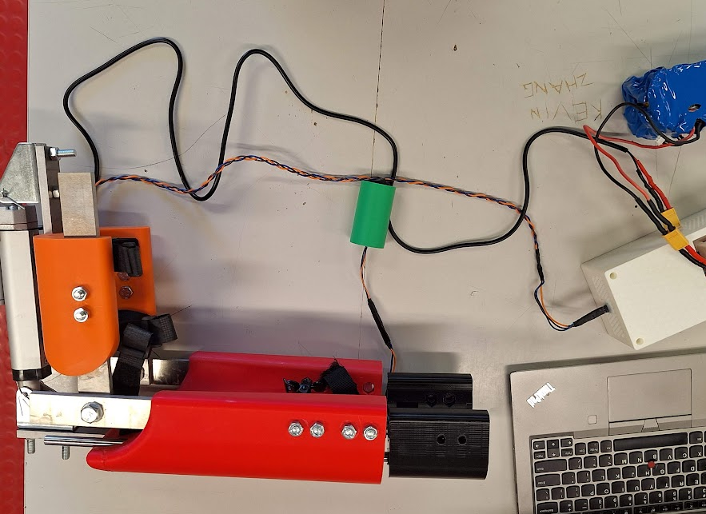
_The completed exoARM device._

---

## Contents

- [Overview](#overview)
- [Project Snapshot](#project-snapshot)
- [Technical Skills](#technical-skills)
- [Design Brief](#design-brief)
- [Design Process](#design-process)
- [Planning](#planning)
- [Development Log](#development-log)
- [Testing & Results](#testing--results)
- [Evaluation & Improvements](#evaluation--improvements)
- [Reflection](#reflection)
- [Documentation](#documentation)
- [License](#license)

---

## Overview

Work-related injury is a common problem in Australia: 497,300 people had a work-related injury or illness in 2023 (3.5% of people who worked at some time during the year). The most common cause of injury or illness was 'Lifting, pushing, pulling or bending' (24%). 66% had time off as a result of the injury or illness. 31% received workers compensation for the injury or illness. (Australian Bureau of Statistics, 2023)

The exoARM system increases the effective force output of the elbow joint, decreasing the muscular work required to lift, push, or pull objects, and reducing the risk of muscular strain and fatigue during prolonged physical work. This is beneficial for both employers and employees, increasing the efficiency of physical tasks while reducing the risk of workers being injured.

The project focused on hinge joints, as they are some of the most load bearing and frequently used joints in the body, and because of their high frequency of use are very commonly injured. The exoARM device is attached to the upper arm and forearm of the user. It uses a control switch to detect the user's input, and the torque of this movement is amplified by a linear actuator controlled by an Arduino program. The exoARM also increases the strength of the elbow joint in static positions, such as when holding something out in front of the user.

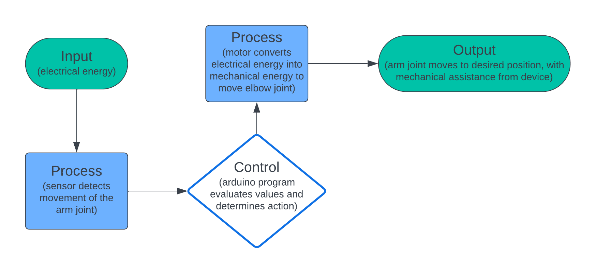
 <em>General IPO diagram of the device's basic features.</em>

---

## Project Snapshot

### Details

|                       |                                                                   |
| --------------------- | ----------------------------------------------------------------- |
| **Course**            | VCAA Systems Engineering, Units 1 & 2 (2024), Viewbank College    |
| **Duration**          | 9 active weeks of a 20-week course allowance                      |
| **Budget constraint** | \$100 (actual cost: \$298.60)                                     |
| **Mechanism**         | First class lever, driven by a 1500N 12V linear actuator          |
| **Control system**    | Arduino Uno R3 + L298N motor controller                           |
| **Power**             | 2 × 12V 3000mAh Li-ion batteries (parallel)                       |
| **Fabrication**       | Water-jet cut aluminium, laser-cut acrylic, FDM 3D printing (PLA) |
| **Final Score**       | 19/30 (63.3%)                                                     |

### Specifications

| Spec                           | Value |
| ------------------------------ | ----- |
| Range of motion                | 60°   |
| Max. force output (calculated) | 535N  |
| Max. load                      | 55kg  |
| Input latency                  | 125ms |
| Weight (excl. battery/circuit) | 5.1kg |

---

## Technical Skills

| Area                 | Skills and tools                                                                              |
| -------------------- | --------------------------------------------------------------------------------------------- |
| Mechanical design    | Lever mechanics, torque, mechanical advantage, range-of-motion analysis                       |
| CAD                  | Autodesk Inventor                                                                             |
| Electronics          | Fritzing, Arduino Uno R3, L298N motor driver, soldering, multimeter testing                   |
| Programming          | Arduino                                                                                       |
| Manufacturing        | Water-jet cutting, laser cutting, FDM 3D printing                                             |
| Engineering practice | Materials selection, project planning, risk assessment, diagnostic testing, design evaluation |

Technical details

- Designed the linkage using lever mathematics, torque calculations, and cosine rule based ROM analysis.
- Modelled parts and assemblies in Autodesk Inventor.
- Designed the control circuit in Fritzing using an Arduino Uno R3 and L298N motor driver.
- Developed Arduino code for motor and limit-switch control.
- Manufactured components using water-jet cutting, laser cutting, and FDM 3D printing
- Assembled and soldered electronics, using heat-shrink insulation and a multimeter for testing.
- Compared material and component options before selecting the final design.
- Planned the project over a 9-week timeline and documented deviations from the original schedule.
- Produced risk assessments and OH&S documentation for tools and manufacturing processes.
- Designed diagnostic tests with defined aims, methods, expected outcomes, and discussion of results.
- Evaluated the completed system against a self-authored design brief.

---

## Design Brief

### Constraints

- The funding of the project received from Viewbank College is limited to \$100, however this can be increased through external funding.
- The time to complete the project is limited to the duration of the VCE Systems Engineering 1 & 2 course (approximately 20 weeks of development).
- The device must be lightweight enough to avoid inducing muscular strain or mechanical strain on joints due to its weight.
- The device must be compact enough to not inhibit freedom of arm movement when working.
- The device must increase the effective mechanical lifting force of the elbow joint when lifting, pulling, or pushing objects during work.
- The device must have tolerance range and speed limits to avoid straining muscles or harming joints by pushing them beyond reasonable ranges of motion or speeds.
  - Must incorporate safety mechanisms to prevent over-assistance, which could potentially cause injury or strain to the user.
  - Should include fail-safe features to immediately disengage the assistance in case of malfunction or user discomfort.
- The device must be able to detect both the position of the elbow joint as well as the acceleration.
- The device must be able to be easily put on or taken off. It also must be able to easily be operated and disengaged.
- All components in the device must be easily obtainable and easily hot swappable in case of failure: wires should not be soldered in place, and should have standard connectors.
- The device should be designed with ergonomic features to ensure user comfort during prolonged use. It must also allow supination and pronation of the forearm while still being able to provide assistance.
- Padding or cushioning should be used throughout the device to minimise pressure points and discomfort on the user's arm.
- The device should allow for adjustability to accommodate different users with varying arm sizes and strength levels.
- The device should have adjustable straps or fasteners to secure it comfortably to the user's arm.

<strong>Considerations</strong>: additional features explored to improve efficiency, quality, and effectiveness

- The ability to increase battery life of the device by using renewable energy sources like thermoelectric generators or solar panels (improving user experience and allowing a smaller, lighter battery).
- A user-friendly interface, such as an online interface or physical buttons and dials (improving accessibility, allowing settings like torque, speed and mode to be toggled without requiring knowledge of programming).
- Sensors which monitor heart rate, and other similar information (helping ensure the user is safe by monitoring if values are within their required ranges).

<strong>Factors influencing Design, Planning, Production & Use</strong>

**Design:**

- Safety of Users (Workers and Employers)
- Functionality
- Aesthetics
- Cost of Components
- Materials and Components Selection

**Planning:**

- Time Available for Production
- Availability of Materials and Components
- Availability of Equipment and Learning Curves
- Risk Management

**Production:**

- Safety
- Knowledge of Process and Use of Equipment
- Quality Control
- Step-by-Step Production Plan

**Use:**

- Safety for Users
- Outdoor Weather Conditions
- Environmental Sustainability
- Cost of Final Product

<strong>Design-brief success criteria</strong>: how the finished device would be judged

| Criteria                                                                       | Reason for Assessment                                                                                                                                                        | Method of Assessment                                                                                                        |
| ------------------------------------------------------------------------------ | ---------------------------------------------------------------------------------------------------------------------------------------------------------------------------- | --------------------------------------------------------------------------------------------------------------------------- |
| Completed within the \$100 budget?                                             | This is measured to ensure that the device remains below the budget limit set by the school, and remains affordable and accessible to all Australians in need of the device. | Keep record of all expenses in the project and compare it to the initial budget.                                            |
| Completed within the 20-week time constraint?                                  | This is assessed as the client requires the device to be submitted before a specified date.                                                                                  | Record the start date of the project and submission date to calculate the time taken to complete the project.               |
| Is the device lightweight enough to avoid inducing muscular/mechanical strain? | If the device is heavy, it could counterproductively lead to an increased rate of fatigue, discomfort, or strain over time.                                                  | Assessing the device's weight against ergonomic standards and user feedback after prolonged trials (10 minutes).            |
| Does the device allow freedom of arm movement?                                 | If the exoARM restricts movement, it would decrease performance in the workplace and also cause safety hazards.                                                              | Measuring the range of motion permitted by the device, and conducting trials performing real world tasks.                   |
| How much does the device increase pulling/pushing force?                       | Gives insight into which types of workplace applications it is appropriate for.                                                                                              | Comparative assessments lifting dumbbells in a bicep curl motion with and without the device augmentation.                  |
| Are tolerance range and speed limits effective?                                | Excessive speeds or ranges of motion could counterproductively lead to an increased rate of fatigue, discomfort, or strain.                                                  | Having users perform real-world tasks and provide feedback on any discomfort, fatigue, or strain.                           |
| Is the device simple to operate, adjust, and disengage?                        | Complex or time-consuming attachment procedures could deter users from utilising the device consistently.                                                                    | Time taken to put on and activate the device should be measured.                                                            |
| Is the device easily repairable?                                               | This is assessed to ensure that the exoARM device is cost-effective and reliable for long term use.                                                                          | Assessing the device's repairability through disassembly trials and component replacement simulations.                      |
| Is the latency of the device low enough to use it effectively?                 | This is assessed to ensure that the device is user friendly and both intuitive and safe to operate.                                                                          | Use a video recording to measure the difference in time between the input and output.                                       |
| Are structural components strong enough to bear heavy loads?                   | If the structural components fail under load, it could lead to injury.                                                                                                       | After applying mechanical stress to the system from usage, visually observe if there are any visible deformities or cracks. |

---

## Design Process

### Research of Similar Products

Existing assistive exoskeleton products on the market share several common features with the exoARM:

- Attached at the upper arm and forearm area, some also supported by the back
- Provide force amplification for the elbow joint

Notable differences investigated across the market:

- **Free swivelling wrist movement** using motors for actuation: _"far more mechanically and technically complex than my project, which would lead it to have a much higher cost and therefore may not be accessible to people in need of the technology."_
- A **windscreen wiper motor** design: _"an affordable approach... it sacrifices force output to achieve such a low cost. The way that the device is supported by the upper back is noteworthy and could be investigated."_
- A **3rd class lever**: _"an alternative approach to force amplification... considered for the device, but ultimately ruled out due to concerns with force output and range of motion."_
- A **pulley system with velcro attachment**: _"the shoulder and torso harness offer an alternative approach to distributing the weight and force, which could enhance user comfort and reduce strain."_

### Motor & Lever Selection

Five actuation approaches were prototyped and evaluated before a final configuration was selected:

| Option                                          | Evaluation                                                                                                                                                             | Conclusion                                                                                             |
| ----------------------------------------------- | ---------------------------------------------------------------------------------------------------------------------------------------------------------------------- | ------------------------------------------------------------------------------------------------------ |
| Servo Motor (Class 3 Lever)                     | Simple torque calculations revealed that it did not provide sufficient torque to drive the arm effectively.                                                            | ❌ Insufficient torque output made this option non-viable.                                             |
| Linear Actuator (Class 3 Lever)                 | Offered a simpler mechanism and substantial force production, but greatly restricted the user's freedom of movement.                                                   | ❌ Restricted movement disqualified this option despite its force advantages.                          |
| Pulley with Servo Motor (Class 3 Lever)         | Similar to the direct servo motor configuration; torque was insufficient even when paired with a pulley system.                                                        | ❌ Inadequate torque output remained an issue.                                                         |
| DC Motor + Flex Sensor (Class 3 Lever)          | Required torque of approximately 250kgF per cm, far beyond the budget constraints and significantly increased the device's weight.                                     | ❌ High torque and budget constraints made this option impractical.                                    |
| Pulley + DC Motor + Flex Sensor (Class 3 Lever) | Aimed to reduce required motor force by half, but still faced issues with force production and added mechanical complexity, increasing the risk of faults.             | ❌ Complexity and insufficient force production rendered this option unsuitable.                       |
| **Linear Actuator (Class 1 Lever)**             | Provided the highest amount of force within the budget and maintained simplicity in the mechanism, which facilitated easier calculations and a straightforward design. | ✅ **Selected** for its balance of high force output, simplicity, and adherence to budget constraints. |

_Motor and lever configurations evaluated during design._

### Lever Mechanics & Calculations

The device's main mechanical feature is a first class lever, with a central fulcrum and a load on either side of the fulcrum.

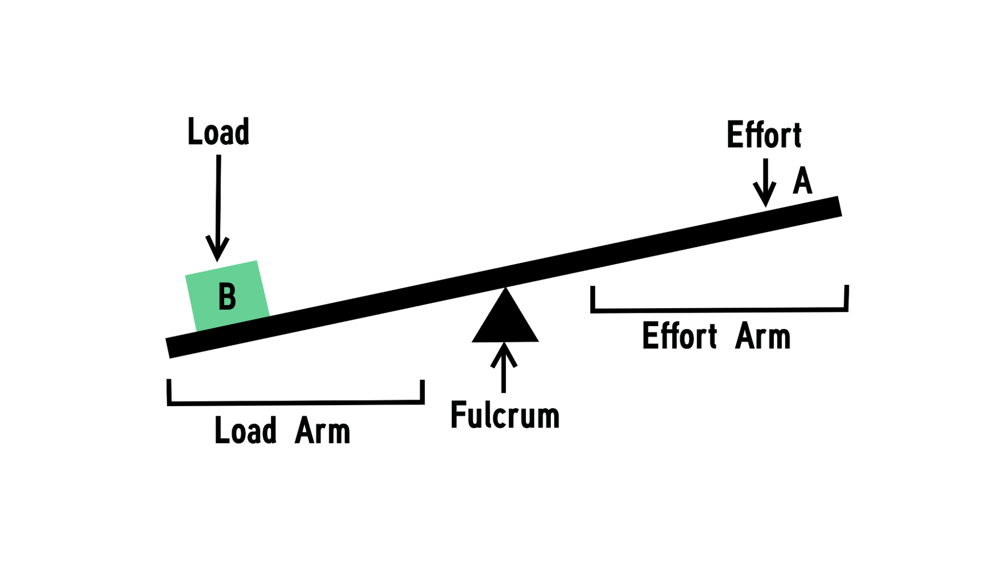

The linear actuator exerts a maximum downwards force of 1500N on the effort arm. Mechanical advantage (the ratio of output force to input force) was used to determine the force exerted on the load arm:

$$\text{Mechanical Advantage (MA)} = \frac{\text{Effort arm length}}{\text{Load arm length}} = \frac{\text{Output force}}{\text{Input force}}$$

Since the maximum input force of the system is 1500N, and the average forearm length is approximately 280mm (fixed as the load arm length to suit most users):

$$F_{\text{output}} = 1500 \times \frac{\text{Effort arm length}}{280}$$

> For users with shorter arms, the maximum force output of the device would be slightly increased, and for users with longer arms, the maximum force output of the device would be slightly decreased.

The linear actuator's 100mm stroke also determines the output displacement, and, using the cosine rule, the device's range of motion in degrees.

**Effort-arm options considered:**

| Effort Arm   | Mechanical Advantage | Max Force | Max Weight | Range of Motion | Comments                                                                                 |
| ------------ | -------------------- | --------- | ---------- | --------------- | ---------------------------------------------------------------------------------------- |
| 28mm         | 1:10                 | 150N      | 15kg       | Unlimited       | Insufficient for heavy lifting applications; full displacement not usable.               |
| 70mm         | 1:4                  | 375N      | 38kg       | 91°             | Sufficient for most heavy lifting; range of motion may be excessive for practical use.   |
| **100mm** ✅ | 5:14                 | 535N      | 55kg       | 60°             | More than sufficient for most heavy lifting; decreased range decreases injury risk.      |
| 140mm        | 1:2                  | 750N      | 76kg       | 42°             | No safe applications for lifting this much weight; range insufficient for practical use. |

Option 3 (100mm) was selected. The maximum lifting force of 535N allows any heavy lifting to be completed easily. Additionally, the 60° range of motion increases safety by preventing hyperextension of the elbow joint.

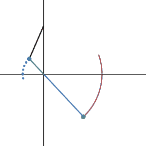
_Simple lever mechanism (blue and green) through its full 60° range of motion, with the linear actuator (black) extending from 0mm to 100mm._

### Power & Circuit Design

The linear actuator is a 12V DC motor, drawing a maximum current of 3A. Two 12V 3000mAh Lithium Ion batteries (each with a maximum current output of 2A) were wired in a parallel configuration to increase the maximum current output.

<table>
<tr>
<td width="50%">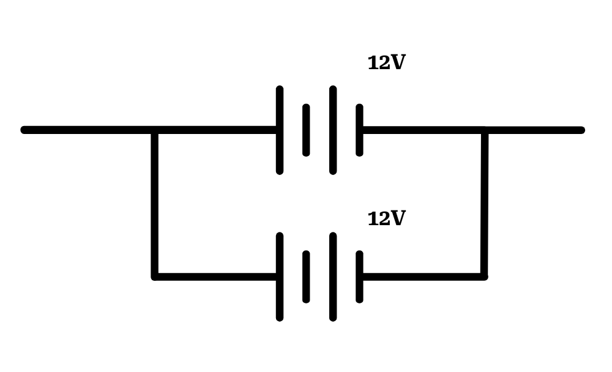 <em>Parallel battery configuration.</em></td>
<td width="50%">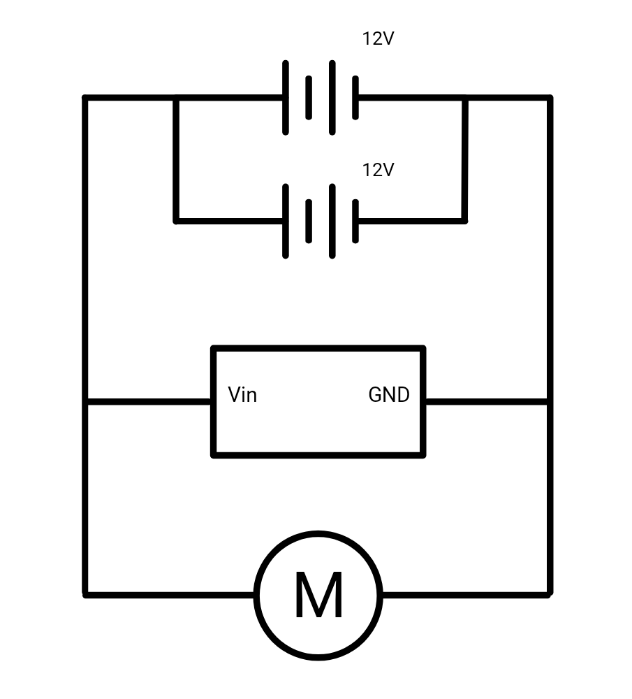 <em>Circuit diagram: linear actuator, Arduino, and batteries.</em></td>
</tr>
</table>

### Component Research

<strong>Mechanical components</strong>: linear actuator, axle, brackets, grease

| Component                   | Selected                             | Justification                                                                                                                                                                               |
| --------------------------- | ------------------------------------ | ------------------------------------------------------------------------------------------------------------------------------------------------------------------------------------------- |
| Linear actuator             | Heavy Duty 12V, 100mm, 1500N (eBay)  | Selected as it was \$51.99, compared to the Amazon alternative at \$72.44. The increased force output also allowed for an increase in the amount of load which can be held with the device. |
| Load-bearing axle           | M10 x 75mm Zinc Plated Hex Head Bolt | The longer bolt provided more flexibility in the thickness of structural parts. The partial threading gave the bolt a smooth, low friction surface to serve as the load bearing axle.       |
| Brackets (hex nuts & bolts) | M8 x 35mm Zinc Plated Hex Head Bolts | Selected due to having more flexibility for the possible addition of thicker parts. If necessary, the bolts can be cut to be shorter using available equipment.                             |
| Grease                      | White lithium grease                 | Selected as a better option due to it being designed for use with metals.                                                                                                                   |

<strong>Electrical components</strong>: control system, motor controller, battery, switches

| Component         | Selected                                    | Justification                                                                                                                                                                  |
| ----------------- | ------------------------------------------- | ------------------------------------------------------------------------------------------------------------------------------------------------------------------------------ |
| Control system    | Arduino Uno R3                              | Selected for the prototype, as it is easily obtainable and has hot swappable connections to allow for easy adjustments.                                                        |
| Motor controller  | L298N motor controller                      | Selected due to its availability in school technology supplies, abundance of documentation, and support for arduino and ESP32.                                                 |
| 12V battery pack  | 12V Rechargeable Li-ion Battery Pack (eBay) | Selected due to its high voltage and current, simplicity, lightweight and small profile, and its ability to be recharged. Additionally, it has switches built into the casing. |
| Controller switch | SPDT Centre Off Rocker Switch               | Selected due to its lower unit price and high availability within Australia (from JayCar).                                                                                     |
| Kill switch       | Switch with LED                             | Selected due to its functionality to visually indicate if the device is running, as well as its higher maximum current.                                                        |

<strong>Materials</strong>: structural metal and 3D printing filament

| Component            | Selected                                          | Justification                                                                                                                                                            |
| -------------------- | ------------------------------------------------- | ------------------------------------------------------------------------------------------------------------------------------------------------------------------------ |
| Metal parts          | Aluminium sheet metal, 8mm                        | Selected mainly because it was simple to precisely cut it into any required shape using the water jet cutter, allowing for efficient CAD design and quick manufacturing. |
| 3D printing filament | Carbon Fibre Filament (final) / PLA+ (prototypes) | Selected for the final product due to its higher strength, which will be useful when the device is subjected to high loads. For early prototypes, PLA+ was used.         |

### Prototype Evolution

<table>
<tr><td width="50%">

**Option 1: Single-sided mechanism**

Initially proposed due to its simplicity in manufacturing. It features a single lever made of a thin acrylic panel with a width of 3mm, with a 3D-printed circular cuff transferring force to the wrist. Simulations showed that the mechanism would fail under the expected loads, and the asymmetrical nature of the mechanism induced torsional strain, increasing the risk of structural failure under load.

</td><td width="50%">

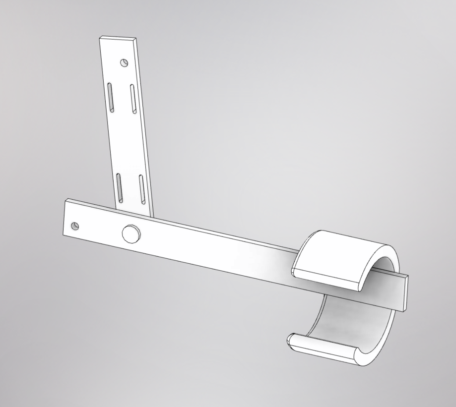

</td></tr>
<tr><td width="50%">

**Option 2: Double-sided (upper range-of-motion bias)**

Developed to reduce torsional strain by placing a lever mechanism on both sides of the arm, with the structural component fabricated from steel rather than acrylic. The major drawback: it biases the range of motion towards the higher end of what the human arm is capable of, so the device cannot fully extend the human arm.

</td><td width="50%">

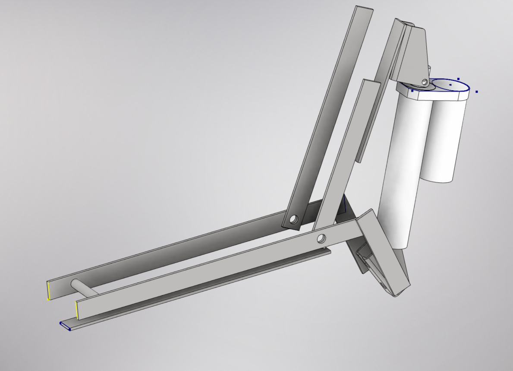

</td></tr>
<tr><td width="50%">

**Option 3: Double-sided (lower range-of-motion bias) ✅ Selected**

The mechanism was simplified, biasing the lower range of motion rather than the upper, increasing practicality for lifting applications. The only major drawback is that the linear actuator sticks out above the shoulder of the user. Selected due to its increased practicality and its ability to effectively bear the forces involved.

</td><td width="50%">

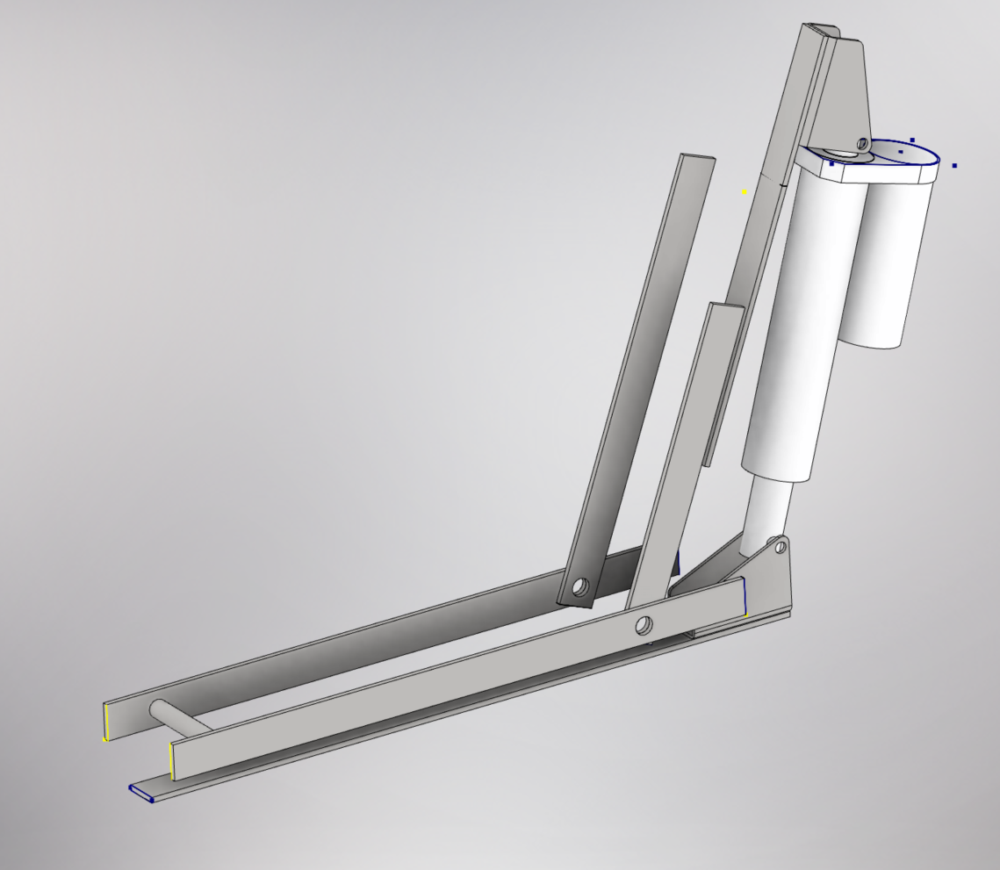

</td></tr>
</table>

---

## Planning

A detailed, week-by-week timeline was developed, outlining the tasks, materials, components, and processes/equipment required at each stage, from initial assembly of mechanical parts through to final circuit assembly and testing.

<strong>Risk assessments</strong>

Risk assessments were sourced and completed for every tool and process used across the build, including the laser cutter, water-jet cutter, 3D printer, digital calipers, soldering iron, heat gun, hot glue gun, cordless drill, multimeter, mallet, pliers, sandpaper, and lithium-ion batteries; each documenting required PPE, operational safety checks, housekeeping procedures, potential hazards, and forbidden practices.

> This SOP does not necessarily cover all possible hazards and should be used in conjunction with other references. It is designed to be used as an adjunct to teaching safety procedures and act as a reminder prior to machine use.

---

## Development Log

Nine weeks of hands-on development: from CAD and circuit design through fabrication, wiring, and final assembly.

| Week      | Highlights                                                                                                                                                                                                                                                                                                                                                                                                                                                                                              |
| --------- | ------------------------------------------------------------------------------------------------------------------------------------------------------------------------------------------------------------------------------------------------------------------------------------------------------------------------------------------------------------------------------------------------------------------------------------------------------------------------------------------------------- |
| **1**     | Finalised the design of the metal components and began designing the plastic 3D printed components to connect the metal beams and aid comfort and load distribution. Completed the circuit diagram (two 12V batteries, Arduino Uno R3, L298N, 1500N linear actuator, an emergency OFF switch, and a rocker switch). Wired components together for independent testing using hot-swappable Dupont connectors, confirming the actuator, Arduino, motor controller, and rocker switch were all functional. |
| **2 & 3** | _No progress was made during these weeks due to illness._                                                                                                                                                                                                                                                                                                                                                                                                                                               |
| **4**     | Purchased ratchet straps for attachment, later found "difficult to tighten and secure when they are on your own arm", prompting a switch to velcro. Water-jet cut all metal parts from a single 300x300x8mm aluminium sheet; all parts were within tolerance. The 12V batteries failed: testing with a multimeter found the output had dropped to 4V, indicating a blown fuse from a short circuit within the battery cells.                                                                            |
| **5**     | Completed the 3D CAD design of the upper and lower arm plastic casts, with all slot and hole dimensions increased by 0.2mm in post to allow tolerance for fit after 3D printing. Test-fitted the lower arm cast on-arm; the metal parts had a tight fit and required a mallet to fully insert, with one part sanded into a wedge shape to fit its slot.                                                                                                                                                 |
| **6**     | Wrote and tested the first Arduino control program, using a 12V power supply in place of the failed batteries. Began 3D printing the upper arm cast (23-hour print, 0.233kg, PLA with breakaway supports): "the current code does not function at all, as the actuator does not extend or retract correctly." One Arduino failed after a wire was placed in the 5V pin instead of the 12V pin.                                                                                                          |
| **7**     | Resolved the faulty Arduino board and incorrect switch/actuator wiring: the actuator now extends and retracts according to the position of the rocker switch. Diagnosed a testing power supply outputting 18V instead of 12V and tuned it to the correct voltage using a multimeter. 3D printed enclosures for the L298N, Arduino, and project box, plus an ergonomic rocker-switch controller housing.                                                                                                 |
| **8**     | Soldered longer wires to the XT60 connector for the L298N for easy battery connect/disconnect. Assembled the main circuit box and wired everything together per the circuit diagram so the circuit functions correctly while completely enclosed, using hot glue as strain relief for the wiring. Created a 1.5-metre, 3-wire braided cable connecting the control switch to the Arduino.                                                                                                               |
| **9**     | Diagnosed a non-functioning switch via continuity testing: the wires in the long cable connector were in the wrong order; once corrected, "the circuit functioned as intended." A battery connector snapped due to the high force required to pull the connectors apart and was re-soldered; a dedicated battery toggle switch was added to prevent discharge. Applied lithium grease to load-bearing joints, with gloves used to avoid skin contact.                                                   |

Gallery

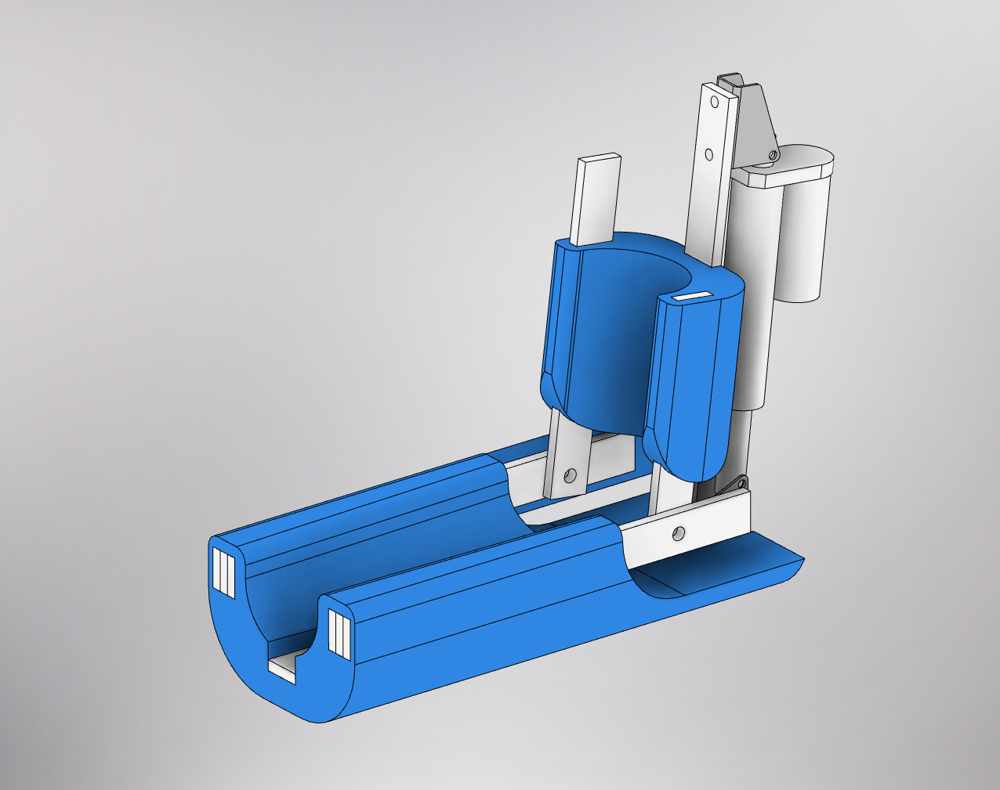
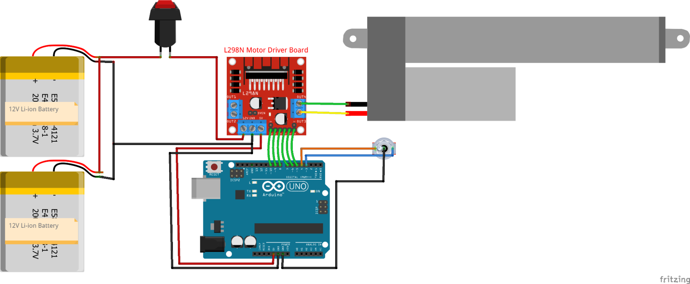
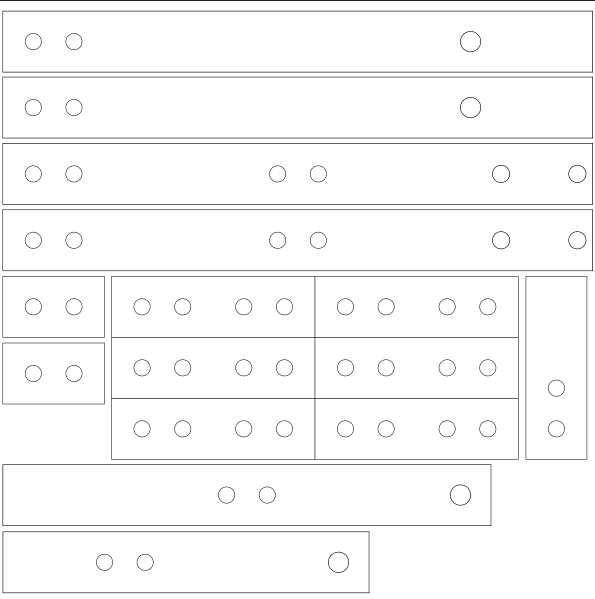
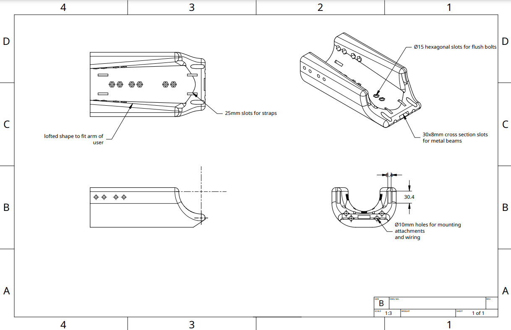
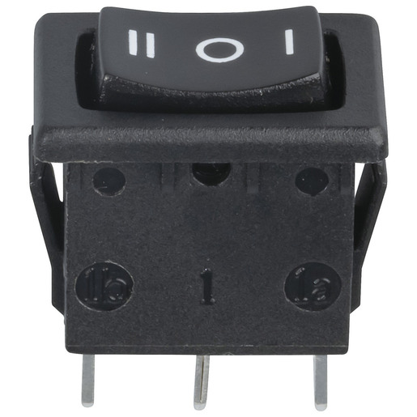

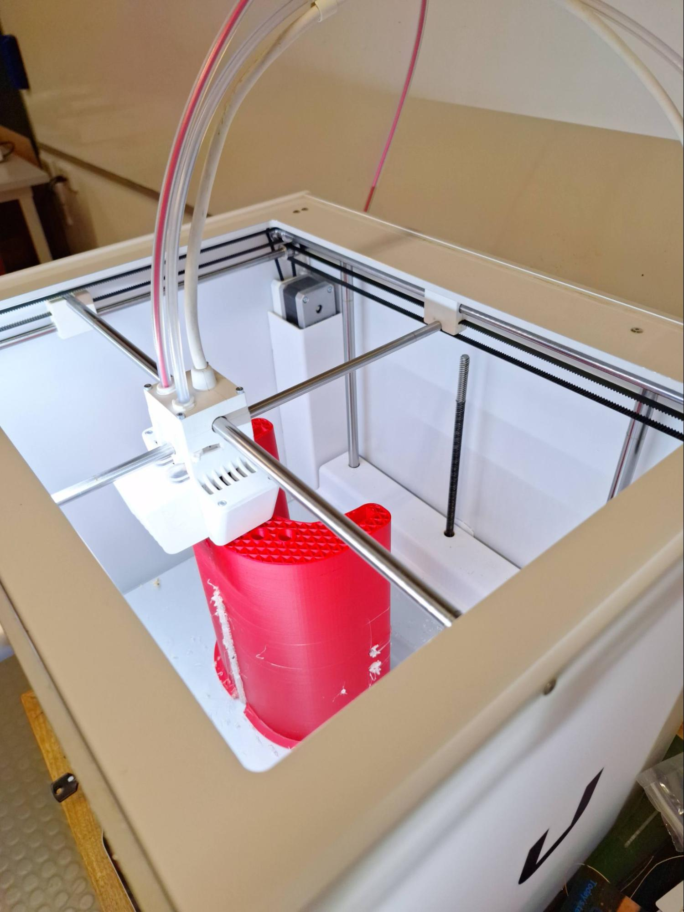
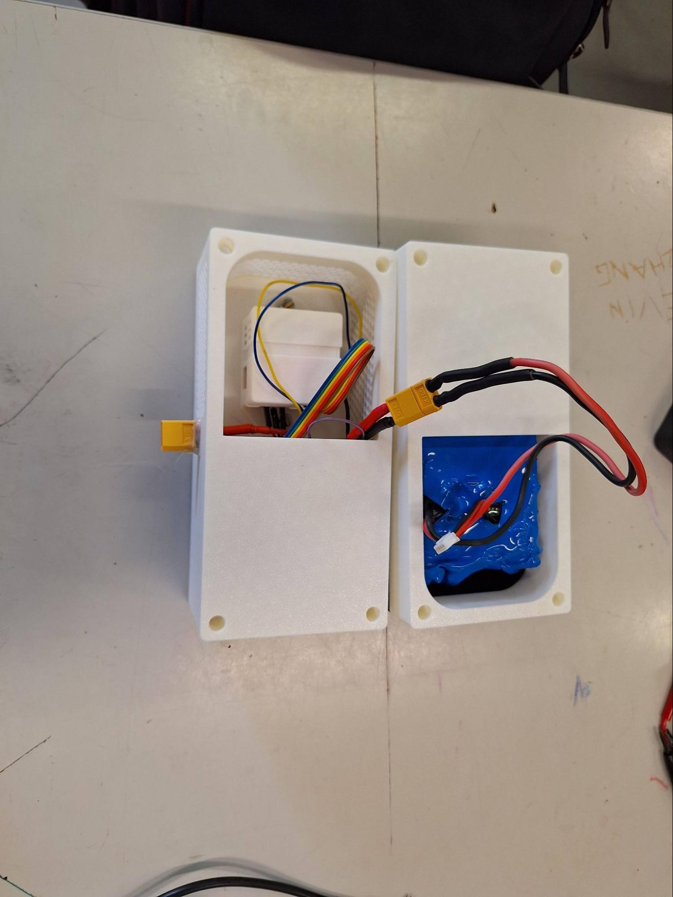
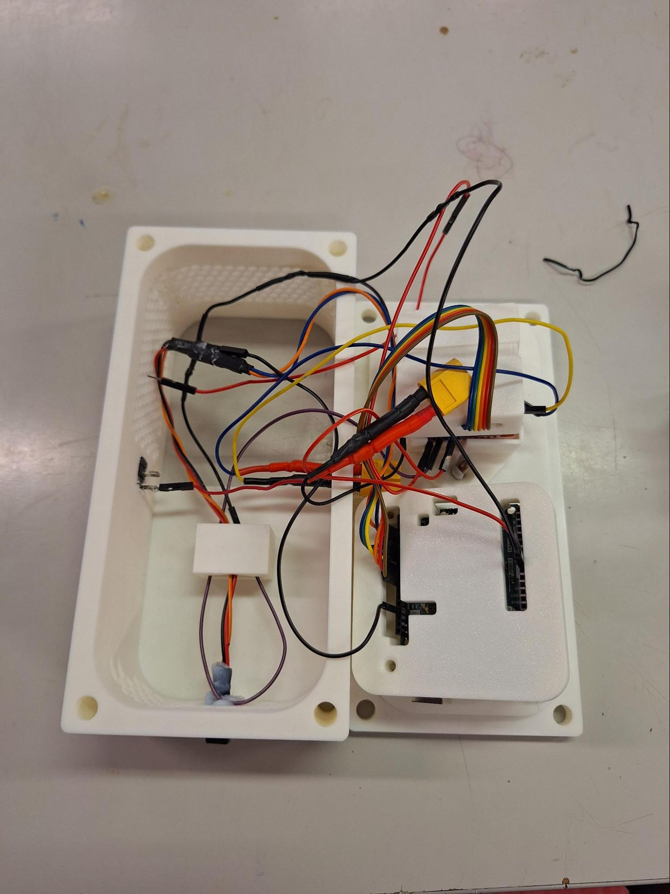

---

## Testing & Results

Seven diagnostic tests were designed and carried out to validate the device against the design brief.

| Test                         | Aim                                                                    | Expected                                                                            | Result                                                                                                                                            | Discussion                                                                                    |
| ---------------------------- | ---------------------------------------------------------------------- | ----------------------------------------------------------------------------------- | ------------------------------------------------------------------------------------------------------------------------------------------------- | --------------------------------------------------------------------------------------------- |
| **1. Range of Motion**       | Measure the range of motion of the device.                             | ≈60° (as calculated)                                                                | ≈60°                                                                                                                                              | Exactly matched the calculated limit.                                                         |
| **2. Force Output**          | Test the effectiveness of the device in assisting with lifting a load. | Device enables user to lift more load, or lift the same load with lower difficulty. | Skipped                                                                                                                                           | Test omitted due to time constraints during the final build phase.                            |
| **3. Load-Bearing Capacity** | Test the durability of the device under load.                          | No cracking or deformation under Test 2 loads.                                      | Skipped                                                                                                                                           | Test omitted due to time constraints during the final build phase.                            |
| **4. Latency**               | Test the time delay between input and device response.                 | Not noticeable (500ms or less)                                                      | ≈125ms (⅛ second)                                                                                                                                 | Significantly better than the 500ms target.                                                   |
| **5. Comfort & Ergonomics**  | Test the comfort of the device when being used.                        | Users will likely have various points of feedback to improve comfort.               | Main points of discomfort: tightness of velcro straps creating pressure points; weight of the device; range of motion too small; lack of padding. | Expected result; first prototype prioritized function over comfort.                           |
| **6. Speed Test**            | Test the time taken between full extension and retraction.             | ≈15 seconds                                                                         | 18 seconds                                                                                                                                        | A bit slower than planned.                                                                    |
| **7. Weight Test**           | Test the overall weight of the device (excluding battery and circuit). | ≈3kg                                                                                | 5.1kg                                                                                                                                             | Heavier than expected, likely due to the density of the 3D prints being higher than expected. |

> ⚠️ Tests 2 and 3 (Force Output and Load-Bearing Capacity) were not completed with recorded results in the original folio.

---

## Evaluation & Improvements

### Final Score: 19/30 (63.3%)

<strong>Full evaluation rubric</strong>

| Criteria               | Low (1)                                   | Medium (2)                                            | High (3)                                               |
| ---------------------- | ----------------------------------------- | ----------------------------------------------------- | ------------------------------------------------------ |
| Budget ($100)          | Final cost above \$110                    | Between \$110 and \$90                                | Under \$90                                             |
| Time (20 weeks)        | More than 20 weeks                        | 15-20 weeks                                           | Less than 15 weeks                                     |
| Lightweight            | Significant discomfort re: weight         | Minor discomfort re: weight                           | No discomfort re: weight                               |
| Freedom of movement    | Range of motion below 60% of the arm's    | Between 60-90% of the arm's                           | Above 90% of the arm's range                           |
| Force increase         | No measurable increase in weight liftable | Measurable increase in weight liftable                | Increase of 50%                                        |
| Tolerance/speed limits | Exceeded range of motion or overspeeding  | Approached the range of motion limit                  | No issues reported                                     |
| Simplicity to operate  | More than 5 minutes to don/activate       | Between 3 and 5 minutes                               | Less than 3 minutes                                    |
| Repairability          | Soldered connections, permanently secured | Standard connectors, some parts less accessible/glued | Standard connectors, easily accessible and replaceable |
| Latency                | Input latency above 500ms                 | Between 150ms and 500ms                               | Lower than average human reaction time (>150ms)        |
| Structural strength    | Major cracks or deformations under load   | Minor cracks or deformations under load               | No cracking or deformation under load                  |

### Project Cost

| Component                                          | Cost                             |
| -------------------------------------------------- | -------------------------------- |
| Lower arm cast (0.958kg PLA + 0.147kg PVA support) | \$54.67                          |
| Upper arm cast (0.233kg PLA)                       | \$5.36                           |
| Circuit box (0.877kg PLA)                          | \$20.07                          |
| 1500N Linear actuator, 12V                         | \$49.39                          |
| Switches (rocker + toggle)                         | \$5.17                           |
| Aluminium sheet                                    | \$73.28                          |
| 12V batteries                                      | \$53.72                          |
| Arduino Uno R3                                     | \$19.99                          |
| L298N motor controller                             | \$16.95                          |
| **Total**                                          | **$298.60** _(vs. \$100 target)_ |

**What Went Well**

- The overarching details of the device, such as the type of lever being used, and the means of transferring force, were extensively considered and mathematically modelled, including speed ratios, mechanical advantage, and animations and diagrams
- Various risk assessments were sourced to minimise any possible risks when using any equipment, and a detailed development roadmap was outlined and followed
- Despite getting sick multiple times throughout the development, and losing almost 3 full weeks of time for development and production, the development plan was able to be closely followed with few deviations
- The use of water-jet cutting for the production of parts was also very successful
- The diagnostic testing and evaluation criteria of the device was successful, and provided insights into how the device performed against the initial constraints of the design brief
- Testing revealed that the device was successful in achieving its original goal of enhancing the strength of the arm of the user

**What Could Be Improved**

- Some details in the planning stage were neglected due to time restraints, and were finalised during the production of the device: the circuit diagram and outline of the code were both not considered until the early weeks of production, rather than in the planning stage
- More time should be allocated for the planning stages, allowing full, labelled 3D models of each prototype, including wiring diagrams, to be considered upfront
- The 3D printed plastic parts were very large, and required an extensive amount of time to 3D print, leading to a high risk of failure and plastic wastage. Regular PLA filament was used instead of the planned carbon fibre reinforced nylon filament due to cost concerns
- The use of PVA support material was not effective, as it left residue and did not fully dissolve as much as desired
- The most major flaws in the design which were discovered in testing included the high cost, and the user discomfort of the device (due to weight and pressure points)
- Many compromises were made compared to the original design brief and constraints, to reduce costs, time, and complexity, indicating the initial goals for the device's performance may have been too ambitious

> Building the exoARM taught me a lot about managing mechanical trade-offs and diagnosing unexpected electrical issues under a tight timeline.

---

## Reflection

The exoARM set out to reduce the muscular strain of lifting, pushing, and pulling tasks by amplifying elbow-joint force through a first-class-lever mechanism. The completed device was calculated to give a 535N maximum force output and 55kg max load capacity (the force and load tests were skipped), with a 60° range of motion and a measured 125ms latency well under the 500ms design target, using a linear actuator, Arduino Uno R3, and L298N motor controller.

The project surfaced clear trade-offs: the final build cost \$298.60 against a \$100 target, weighed 5.1kg against a roughly 3kg estimate, and testing surfaced discomfort from strap pressure points and device weight. These findings point to concrete next steps, such as using carbon-fibre-reinforced components and a redesigned padding system. Ultimately, the lessons I learned about managing trade-offs were the most useful outcome of the project.

---

## Documentation

The complete folio (including all risk assessments, full development log entries, CAD screenshots, and raw test footage) is available as the [full folio PDF](docs/exoARM_Folio.pdf).

Source code: [`actuator-control-v1.ino`](code/actuator-control-v1.ino), [`actuator-control-v2.ino`](code/actuator-control-v2.ino). Original CAD files are no longer available.

## License

This project is licensed under the MIT License. See the [LICENSE](LICENSE) file for details.

---

Completed as part of the VCAA Systems Engineering study design at Viewbank College.

